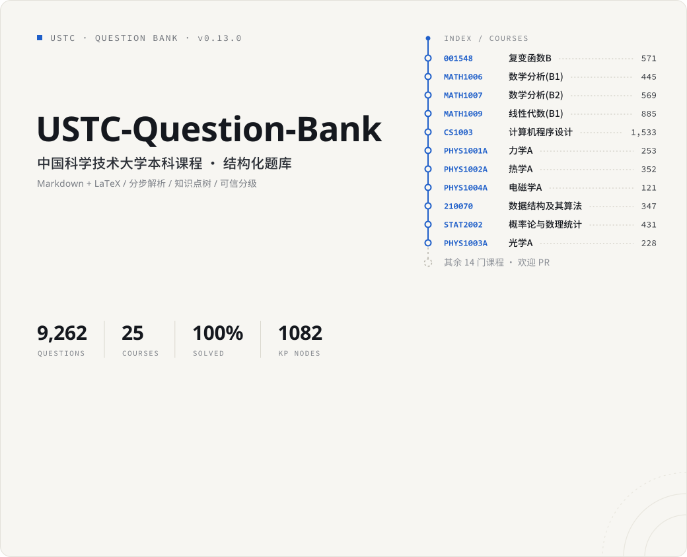

<div align="center">
<picture>
  <source media="(prefers-color-scheme: dark)" srcset=".github/assets/hero-dark.svg" />
  <source media="(prefers-color-scheme: light)" srcset=".github/assets/hero.svg" />
  
</picture>
<p>
  <a href="LICENSE"></a>
  <a href="python/ustc_qbank">=3.10" src="https://img.shields.io/badge/python-%E2%89%A53.10-3A7BE0?style=flat-square&labelColor=24292F&logo=python&logoColor=white" /></a>
  <a href="types/index.d.ts"></a>
  <a href="scripts/build_sqlite.py"></a>
</p>
<p>
  <a href="#收录一览">01 收录一览</a> &nbsp;&nbsp;
  <a href="#仓库结构">02 仓库结构</a> &nbsp;&nbsp;
  <a href="#作为库使用">03 作为库使用</a> &nbsp;&nbsp;
  <a href="#ai-与数据管线说明">04 AI 管线</a> &nbsp;&nbsp;
  <a href="#上游来源">05 上游来源</a> &nbsp;&nbsp;
  <a href="#寻找-contributor--加入共建">06 加入共建</a> &nbsp;&nbsp;
  <a href="#联系方式">07 联系方式</a>
</p>
</div>

面向中国科学技术大学（USTC）本科课程的**结构化、可编程题库底座**。每道题含 Markdown + LaTeX 题干、答案、分步解析、知识点树标签与可信分级，可直接驱动刷题网站、LaTeX 组卷、Anki 制卡、RAG 检索与评测基准。

> **许可边界**：仓库代码、Schema、知识点树与元数据采用 [MIT License](LICENSE)；第三方真题、教材习题及引用解答版权归原权利人所有，**不适用 MIT**，详阅 [NOTICE.md](NOTICE.md)。


## 收录一览

| 课号 | 课程 | 总题数 | `official` | `community` | `ai` | 隔离 | 真题年份 | 知识点 |
| --- | --- | ---: | ---: | ---: | ---: | ---: | --- | ---: |
| `001548` | 复变函数B | 571 | 229 | 26 | 316 | 7 | 2003–2025 | 35 |
| `MATH1006` | 数学分析(B1) | 445 | 133 | 300 | 12 | 0 | 2016–2025 | 31 |
| `MATH1007` | 数学分析(B2) | 569 | 131 | 438 | 0 | 0 | 2018–2026 | 28 |
| `MATH1009` | 线性代数(B1) | 885 | 611 | 273 | 1 | 0 | 2011–2026 | 41 |
| `CS1003` | 计算机程序设计 | 1,533 | 1,231 | 188 | 114 | 0 | 2018–2025 | 31 |
| `PHYS1001A` | 力学A（含 91 张配图） | 253 | 49 | 1 | 203 | 14 | 2006–2025 | 46 |
| `PHYS1002A` | 热学A（含 48 张配图） | 352 | 219 | 13 | 120 | 10 | 2004–2026 | 45 |
| `PHYS1004A` | 电磁学A（含 59 张配图） | 121 | 43 | 0 | 78 | 7 | 2017–2026 | 47 |
| `210070` | 数据结构及其算法（含 17 张配图） | 347 | 71 | 145 | 131 | 0 | 2008–2024 | 46 |
| `STAT2002` | 概率论与数理统计（含 1 张配图） | 431 | 327 | 0 | 104 | 3 | 2003–2025 | 48 |
| `PHYS1003A` | 光学A（含 17 张配图） | 228 | 121 | 16 | 91 | 10 | 2020–2025 | 51 |
| `210050` | 数字逻辑电路（含 72 张配图） | 92 | 29 | 23 | 40 | 0 | 2015–2022 | 51 |
| **合计** | **12 门课程** | **5,827** | **3,194** | **1,423** | **1,210** | **51** | — | **500** |

- **100% 含答案与分步解析**。`official` 为原卷/书末标答，`community` 为非官方书面详解，`ai` 为模型或独立推导。

<details>
<summary>展开查看各课程批次明细与已知勘误说明</summary>

- **`001548` 复变函数B**：`complex_b` (225，14 套期末含补考)、`complex_b_midterm` (3，2023 期中)、`jiangyi_examples` (10，舒文炫讲义)、`github_workbook` (40，[`jieyou520/-`](https://github.com/jieyou520/-))、`yan_complex` (127，严镇军《复变函数》第 2 版)、`yan_mp_part1` (99，与 `yan_complex` 部分重叠，去重可排除)、`yan_mp_part2` (67，《数学物理方法》第二篇)。
- **`MATH1006` 数学分析(B1)**：`ma1_exams` (145，2016 小测 + 2017–2025 期中/期末 18 套)、`ma1_textbook` (300，《数学分析讲义》第一册，[`DongYaoZe`](https://github.com/DongYaoZe/math-analysis-lectures-solutions-USTC) 详解)。
- **`MATH1007` 数学分析(B2)**：`ma2_exams` (131，2018–2026 期中/期末 17 套)、`ma2_textbook` (438，《数学分析讲义》第二册，[`DongYaoZe`](https://github.com/DongYaoZe/math-analysis-lectures-solutions-USTC) 详解)。
- **`MATH1009` 线性代数(B1)**：`la1_exams` (566，2010–2026 学年 42 套期中/期末，含花开花败 20 套参考解答 + 22 套单卷)、`la1_textbook` (319，李尚志《线性代数学习指导》第 1–4、6、8、9 章例题分析与解答)。
- **`CS1003` 计算机程序设计**：`cs1_exams` (334，2018–2025 期中/期末/补考/机考 13 套)、`cs1_quiz` (319，2012 学习指导 + 2024 秋模拟 + 2025 版复习测试各 4 套)、`cs1_banks` (750，三份公开 C 语言题库)、`cs1_drill` (130，指针专题、期中练习与习题课课件)。
- **`PHYS1001A` 力学A**：`mech1_exams` (105，2016–2026 学年期中/期末 14 套，含 A(L) 班卷)、`mech1_quiz` (147，2005–2016 力学历年考题合集 15 套)、`mech1_drill` (1，刚体笔记例题)；86 道带图题共附 91 张配图（`courses/PHYS1001A/assets/`，70 张灰度 WebP + 21 张矢量重绘 SVG，合计 449 KB）。
- **`PHYS1002A` 热学A**：`therm1_exams` (105，2016–2026 期中/期末/预考/免修考与公共题)、`therm1_quiz` (233，热学历年真题合订本 10 卷 + 2021 三次小测 + 清华《大学物理》热学选择题库 86 题)、`therm1_drill` (14，2023 春 wxf 班参考题)；48 道带图题共附 48 张配图（`courses/PHYS1002A/assets/`，25 张灰度 WebP + 23 张矢量重绘 SVG，合计 124.7 KB）。
- **`PHYS1004A` 电磁学A**：`em1_exams` (107，2017–2026 期中/期末公共题、各班回忆版与 2023 秦敢期中样题)、`em1_quiz` (4，课堂练习/小测)、`em1_drill` (10，磁场习题课讲稿例题)；58 道带图题共附 59 张配图（`courses/PHYS1004A/assets/`，33 张灰度 WebP + 26 张矢量重绘 SVG，合计 212.2 KB）。
- **`210070` 数据结构及其算法**：`ds1_exams` (174，2008–2019 四学年期末、2024 秋期末及《数据结构》试卷A)、`ds1_drill` (173，2-4-6-8 / 3-5-7-9 / 10.24 习题课讲义与六次课程作业)；17 道含关键图例题附配图（`courses/210070/assets/`，14 张灰度 WebP + 3 张矢量重绘 SVG，合计 102.1 KB）。
- **`STAT2002` 概率论与数理统计**：`stat1_exams` (431，2002–2026 学年共 36 套期末/期中真题，含 327 题原卷/合集标答与 104 题独立解析，3 题因缺表或设问不严隔离)；`2002–2003` 期末第一题附五开关桥式电路矢量 SVG 配图（`courses/STAT2002/assets/STAT2002-exam-2003s-f-01-fig1.svg`）。
- **`PHYS1003A` 光学A**：`opt1_exams` (98，2020–2026 学年 6 套期末与模拟试卷，含 2023 秋卷面手写批注答案版)、`opt1_drills` (107，《光学复习指导》第 1–7 章例题与作业题)、`opt1_sets` (23，《光学A习题集》)；17 道真题带图题附经去边与均衡增强的灰度 WebP 配图（`courses/PHYS1003A/assets/`，合计 155.6 KB）。
- **`210050` 数字逻辑电路**：`dl1_exams` (92，2015–2023 学年 7 套期末真题与 2020 秋 06 班模拟卷，含 2019–2020 与 2020–2021 助教手写答案版)；58 道带图题附按题精裁 WebP 与去手写空白矢量 SVG（`courses/210050/assets/`，69 张灰度 WebP + 3 张 SVG，合计 526.8 KB）。
- 详细勘误与局限见各课程 `courses/<课号>/meta.json` 的 `known_notes`。

</details>


## 仓库结构

按 USTC 官方课号组织，纯文本 JSONL 入库，原生预留带图题（`figures` + `assets/` + `asset_base_url`）与选择题（`options`）：

```text
USTC-Question-Bank/
├── manifest.json                 # 全库索引、统计、SHA-256 与外置资产基址
├── schema/                       # JSON Schema (2020-12): manifest / question / taxonomy
├── courses/<course_code>/        # 001548 / MATH1006 / MATH1007 / MATH1009 / CS1003 / PHYS1001A / ...
│   ├── meta.json                 # 课程元数据与批次统计
│   ├── taxonomy.json             # 知识点层次树
│   ├── questions.jsonl           # 单题流（按稳定全局 ID 排序）
│   └── assets/                   # （按需）带图题的 SVG / WebP / PNG 配图
├── python/ustc_qbank/            # 零依赖 Python 加载库与 SQLite FTS5 构建器
├── types/index.d.ts              # TypeScript 类型定义
└── scripts/                      # validate.py（CI 全量体检）与 build_sqlite.py
```

<details>
<summary>展开查看单题 JSON 契约示例</summary>

```json
{
  "id": "001548-exam-2003f-01",
  "course_code": "001548",
  "schema_version": "1.0",
  "type": "blank",
  "stem": { "md": "设方程 $z^{3}=\\bar{z}$，求 $z$。", "figures": [] },
  "options": [],
  "answer": {
    "md": "$z\\in\\{0,\\ 1,\\ -1,\\ \\mathrm{i},\\ -\\mathrm{i}\\}$",
    "figures": [],
    "origin": "ai",
    "origin_detail": "入库时独立推导"
  },
  "solution": { "md": "...", "steps": ["..."], "figures": [] },
  "tags": { "kp_ids": ["cplx.eq"], "keywords": ["复方程求解"], "difficulty": 2 },
  "source": {
    "kind": "exam_paper",
    "batch": "complex_b",
    "ref": "2003-2004学年第一学期复变函数（B）期末 第一(1)题",
    "year": 2003,
    "term": "2003-2004-1",
    "exam_kind": "final",
    "url": "https://share.feixu.site/数学类/复变函数/复变函数历年真题.pdf",
    "rights": "third_party_exam"
  },
  "quality": {
    "quarantined": false,
    "quarantine_reason": null,
    "confidence": null,
    "note": null,
    "overlap_hint": null
  }
}
```

</details>


## 作为库使用

**Python（零第三方依赖）**

```bash
git clone https://github.com/DDNdles/USTC-Question-Bank.git && pip install -e ./USTC-Question-Bank
# 中科大校内 / 国内直连镜像（git.ustc.edu.cn，自动同步）：
# git clone https://git.ustc.edu.cn/zzl_stella05/USTC-Question-Bank.git
```

```python
from ustc_qbank import QuestionBank

bank = QuestionBank("./USTC-Question-Bank")
qs = bank["MATH1006"].query(kp="ma1.lim", origins=["official"], difficulty=(2, 4))
paper = bank["001548"].sample(12, seed=2026, exclude_batches=["yan_mp_part1"])
```

- **SQLite FTS5**：`python scripts/build_sqlite.py -o dist/ustc-question-bank.sqlite`
- **TypeScript / 前端**：直接引入 [types/index.d.ts](types/index.d.ts)，按 `manifest.json` 拉取 Raw JSONL
- **Hugging Face / RAG**：`load_dataset("json", data_files="courses/MATH1006/questions.jsonl")`
- **本地校验**：`python scripts/validate.py && python -m unittest discover -s tests -v`


## AI 与数据管线说明

所有 AI 产出均通过 `answer.origin` 与 `quality` 透明标注：

| 环节 | 模型 / 工具 | 说明 |
| --- | --- | --- |
| 仓库架构与工程设计 |  [**Gemini 4 Neon**](https://deepmind.google/technologies/gemini/) | 数据契约、Schema、Python/TS 库、SQLite FTS5 与 CI 校验架构 |
| 题目分析、标注与无答案题解析 |  [**DeepSeek-v4.1-flash-1017**](https://github.com/deepseek-ai) ·  [**GLM-5.3-Flash**](https://github.com/zai-org) | 题目切分结构化、知识点与难度标注、勘误复核及无答案题独立求解 |
| 数分教材详解上游底本 |  [**Gemini Pro**](https://deepmind.google/technologies/gemini/)（[`DongYaoZe`](https://github.com/DongYaoZe/math-analysis-lectures-solutions-USTC) 上游） | 原作者前言注明以 Gemini Pro 会员起草初稿并经多轮人工校订（未注明具体小版本），入库时已二次复核 |
| 试卷与教材 PDF OCR | <a href="https://github.com/opendatalab/MinerU"></a> / PaddleOCR-VL @  [**107.ustc.edu.cn**](https://107.ustc.edu.cn/) | 在中科大 107 平台自部署 MinerU / PaddleOCR-VL GPU 作业完成版面、公式与插图裁剪 |


## 上游来源

| 上游项目 / 站点 | 对应内容 | 链接 |
| --- | --- | --- |
| 中科大本科课程资料导航 | 课程资料总索引入口 | [TwinJades/USTC_Study_Materials_Navigation](https://github.com/TwinJades/USTC_Study_Materials_Navigation) |
| feixu 镜像站 | 数学/物理/计算机历年真题、题库、参考解答与复习讲义 | [share.feixu.site](https://share.feixu.site/) |
| USTC Math Exam | 复变/数分/线代近年真题卷面 PDF | [ustcmathexam.github.io](https://ustcmathexam.github.io/) |
| USTC Physics Exam | 力学A / 热学A / 电磁学A 历年真题卷面 PDF | [ustcphyexam.github.io](https://ustcphyexam.github.io/) |
| USTC 评课社区 | 复变/线代/程序设计/力学真题、解答与笔记附件 | [icourse.club](https://icourse.club/) |
| 《数学分析讲义》非官方习题详解 | 数分 B1/B2 教材第 1–13 章详解底本（`origin=community`） | [DongYaoZe/math-analysis-lectures-solutions-USTC](https://github.com/DongYaoZe/math-analysis-lectures-solutions-USTC) |
| 复变函数期末复习题库 | 复变 40 题复习题集（`github_workbook`） | [jieyou520/-](https://github.com/jieyou520/-) |
| 数学分析历年真题汇编与讲义 | 补充卷面与课程范围核对 | [Passiflora-sago/Passiflora-sago.github.io](https://github.com/Passiflora-sago/Passiflora-sago.github.io) |
| 线代 / 计科公开课程资料归档 | 线代 B1、计算机程序设计及数据结构历年真题、答案汇编与习题课 | [fandahao17/USTC-CS-Courses-Resource](https://github.com/fandahao17/USTC-CS-Courses-Resource) · [Wloner0809/ustc-course-resource](https://github.com/Wloner0809/ustc-course-resource) · [guch8017/USTC_CS_EXAM](https://github.com/guch8017/USTC_CS_EXAM) · [duxiaoyang/USTC-Course-Materials](https://github.com/duxiaoyang/USTC-Course-Materials) · [ly382965/USTC_learning_materials](https://github.com/ly382965/USTC_learning_materials) · [li-qi-lin/USTC-Course-Materials-Sharing](https://github.com/li-qi-lin/USTC-Course-Materials-Sharing) |

完整版权归属与侵删渠道见 [NOTICE.md](NOTICE.md)。


## 寻找 Contributor · 加入共建

目标是覆盖中科大尽可能多的本科核心课程（线代 B2/A、概率、大物、数理方法、计科与各院专业课）。单人维护覆盖全校非常吃力，**欢迎所有中科大同学与校友加入共建**：

- 认领一门你熟悉的课程，哪怕先补录 1 套结构化真题
- 刷题顺手提 [勘误 Issue](.github/ISSUE_TEMPLATE/errata.yml) 或 PR（详见 [CONTRIBUTING.md](CONTRIBUTING.md)）
- 帮忙核对低置信题、重绘清晰 SVG/WebP 题图，或基于本库构建刷题/Anki/组卷工具


## 联系方式

- **GitHub**：[@DDNdles](https://github.com/DDNdles) · [Issues](https://github.com/DDNdles/USTC-Question-Bank/issues)
- **USTC GitLab 镜像**：[git.ustc.edu.cn/zzl_stella05/USTC-Question-Bank](https://git.ustc.edu.cn/zzl_stella05/USTC-Question-Bank)（校内/国内免梯子直连，自动同步）
- **中科大邮箱**：[zzl_stella05@mail.ustc.edu.cn](mailto:zzl_stella05@mail.ustc.edu.cn)
