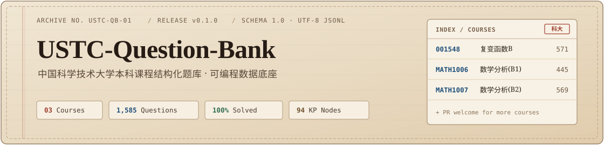

<div align="center">

<picture>
  <source media="(prefers-color-scheme: dark)" srcset=".github/assets/hero-kraft-dark.svg" />
  <source media="(prefers-color-scheme: light)" srcset=".github/assets/hero-kraft.svg" />
  
</picture>

<br />

<a href="LICENSE"></a>
<a href="manifest.json"></a>
<a href="python/ustc_qbank">=3.10" src="https://img.shields.io/badge/Python-%E2%89%A53.10-4D6B53?style=flat-square&labelColor=3B2F27&logo=python&logoColor=F2E8D5" /></a>
<a href="types/index.d.ts"></a>
<a href="scripts/build_sqlite.py"></a>

<p>
  <a href="#收录一览">收录一览</a> &nbsp;·&nbsp;
  <a href="#仓库结构">仓库结构</a> &nbsp;·&nbsp;
  <a href="#作为库使用">作为库使用</a> &nbsp;·&nbsp;
  <a href="#ai-与数据管线说明">AI 管线</a> &nbsp;·&nbsp;
  <a href="#上游来源">上游来源</a> &nbsp;·&nbsp;
  <a href="#寻找-contributor--加入共建">加入共建</a>
</p>

</div>

---

面向中国科学技术大学（USTC）本科课程的**结构化、可编程题库底座**。每道题含 Markdown + LaTeX 题干、答案、分步解析、知识点树标签与可信分级，可直接驱动刷题网站、LaTeX 组卷、Anki 制卡、RAG 检索与评测基准。

> **许可边界**：仓库代码、Schema、知识点树与元数据采用 [MIT License](LICENSE)；第三方真题、教材习题及引用解答版权归原权利人所有，**不适用 MIT**，详阅 [NOTICE.md](NOTICE.md)。

## 收录一览

| 课号 | 课程 | 总题数 | `official` | `community` | `ai` | 隔离 | 真题年份 | 知识点 |
| --- | --- | ---: | ---: | ---: | ---: | ---: | --- | ---: |
| `001548` | 复变函数B | 571 | 229 | 26 | 316 | 7 | 2003–2025 | 35 |
| `MATH1006` | 数学分析(B1) | 445 | 133 | 300 | 12 | 0 | 2016–2025 | 31 |
| `MATH1007` | 数学分析(B2) | 569 | 131 | 438 | 0 | 0 | 2018–2026 | 28 |
| **合计** | **3 门课程** | **1,585** | **493** | **764** | **328** | **7** | — | **94** |

- **100% 含答案与分步解析**。`official` 为原卷/书末标答，`community` 为非官方书面详解，`ai` 为模型或独立推导。

<details>
<summary>展开查看各课程批次明细与已知勘误说明</summary>

- **`001548` 复变函数B**：`complex_b` (225，14 套期末含补考)、`complex_b_midterm` (3，2023 期中)、`jiangyi_examples` (10，舒文炫讲义)、`github_workbook` (40，[`jieyou520/-`](https://github.com/jieyou520/-))、`yan_complex` (127，严镇军《复变函数》第 2 版)、`yan_mp_part1` (99，与 `yan_complex` 部分重叠，去重可排除)、`yan_mp_part2` (67，《数学物理方法》第二篇)。
- **`MATH1006` 数学分析(B1)**：`ma1_exams` (145，2016 小测 + 2017–2025 期中/期末 18 套)、`ma1_textbook` (300，《数学分析讲义》第一册，[`DongYaoZe`](https://github.com/DongYaoZe/math-analysis-lectures-solutions-USTC) 详解)。
- **`MATH1007` 数学分析(B2)**：`ma2_exams` (131，2018–2026 期中/期末 17 套)、`ma2_textbook` (438，《数学分析讲义》第二册，[`DongYaoZe`](https://github.com/DongYaoZe/math-analysis-lectures-solutions-USTC) 详解)。
- 详细勘误与局限见各课程 `courses/<课号>/meta.json` 的 `known_notes`。

</details>

## 仓库结构

按 USTC 官方课号组织，纯文本 JSONL 入库，原生预留带图题（`figures` + `assets/` + `asset_base_url`）与选择题（`options`）：

```text
USTC-Question-Bank/
├── manifest.json                 # 全库索引、统计、SHA-256 与外置资产基址
├── schema/                       # JSON Schema (2020-12): manifest / question / taxonomy
├── courses/<course_code>/        # 001548 / MATH1006 / MATH1007 / ...
│   ├── meta.json                 # 课程元数据与批次统计
│   ├── taxonomy.json             # 知识点层次树
│   ├── questions.jsonl           # 单题流（按稳定全局 ID 排序）
│   └── assets/                   # （按需）带图题的 SVG / WebP / PNG 配图
├── python/ustc_qbank/            # 零依赖 Python 加载库与 SQLite FTS5 构建器
├── types/index.d.ts              # TypeScript 类型定义
└── scripts/                      # validate.py（CI 全量体检）与 build_sqlite.py
```

<details>
<summary>展开查看单题 JSON 契约示例</summary>

```json
{
  "id": "001548-exam-2003f-01",
  "course_code": "001548",
  "schema_version": "1.0",
  "type": "blank",
  "stem": { "md": "设方程 $z^{3}=\\bar{z}$，求 $z$。", "figures": [] },
  "options": [],
  "answer": {
    "md": "$z\\in\\{0,\\ 1,\\ -1,\\ \\mathrm{i},\\ -\\mathrm{i}\\}$",
    "figures": [],
    "origin": "ai",
    "origin_detail": "入库时独立推导"
  },
  "solution": { "md": "...", "steps": ["..."], "figures": [] },
  "tags": { "kp_ids": ["cplx.eq"], "keywords": ["复方程求解"], "difficulty": 2 },
  "source": {
    "kind": "exam_paper",
    "batch": "complex_b",
    "ref": "2003-2004学年第一学期复变函数（B）期末 第一(1)题",
    "year": 2003,
    "term": "2003-2004-1",
    "exam_kind": "final",
    "url": "https://share.feixu.site/数学类/复变函数/复变函数历年真题.pdf",
    "rights": "third_party_exam"
  },
  "quality": {
    "quarantined": false,
    "quarantine_reason": null,
    "confidence": null,
    "note": null,
    "overlap_hint": null
  }
}
```

</details>

## 作为库使用

**Python（零第三方依赖）**

```bash
git clone https://github.com/DDNdles/USTC-Question-Bank.git && pip install -e ./USTC-Question-Bank
```

```python
from ustc_qbank import QuestionBank

bank = QuestionBank("./USTC-Question-Bank")
qs = bank["MATH1006"].query(kp="ma1.lim", origins=["official"], difficulty=(2, 4))
paper = bank["001548"].sample(12, seed=2026, exclude_batches=["yan_mp_part1"])
```

- **SQLite FTS5**：`python scripts/build_sqlite.py -o dist/ustc-question-bank.sqlite`
- **TypeScript / 前端**：直接引入 [types/index.d.ts](types/index.d.ts)，按 `manifest.json` 拉取 Raw JSONL
- **Hugging Face / RAG**：`load_dataset("json", data_files="courses/MATH1006/questions.jsonl")`
- **本地校验**：`python scripts/validate.py && python -m unittest discover -s tests -v`

## AI 与数据管线说明

所有 AI 产出均通过 `answer.origin` 与 `quality` 透明标注：

| 环节 | 模型 / 工具 | 说明 |
| --- | --- | --- |
| 仓库架构与工程设计 |  [**Gemini 4 Neon**](https://deepmind.google/technologies/gemini/) | 数据契约、Schema、Python/TS 库、SQLite FTS5 与 CI 校验架构 |
| 题目分析、标注与无答案题解析 |  [**DeepSeek-v4.1-flash-1017**](https://github.com/deepseek-ai) | 题目切分结构化、知识点与难度标注、勘误复核及无答案题独立求解 |
| 数分教材详解上游底本 |  [**Gemini Pro**](https://deepmind.google/technologies/gemini/)（[`DongYaoZe`](https://github.com/DongYaoZe/math-analysis-lectures-solutions-USTC) 上游） | 原作者前言注明以 Gemini Pro 会员起草初稿并经多轮人工校订（未注明具体小版本），入库时已二次复核 |
| 试卷与教材 PDF OCR | <a href="https://github.com/opendatalab/MinerU"></a> @  [**107.ustc.edu.cn**](https://107.ustc.edu.cn/) | 在中科大 107 平台自部署 MinerU GPU 作业完成版面与公式解析 |

## 上游来源

| 上游项目 / 站点 | 对应内容 | 链接 |
| --- | --- | --- |
| 中科大本科课程资料导航 | 课程资料总索引入口 | [TwinJades/USTC_Study_Materials_Navigation](https://github.com/TwinJades/USTC_Study_Materials_Navigation) |
| feixu 镜像站 | 复变/数分历年真题、参考答案、舒文炫复习讲义 | [share.feixu.site](https://share.feixu.site/) |
| USTC Math Exam | 复变/数分近年真题卷面 PDF | [ustcmathexam.github.io](https://ustcmathexam.github.io/) |
| USTC 评课社区 | 2023 秋复变函数B期中参考答案 | [icourse.club](https://icourse.club/) |
| 《数学分析讲义》非官方习题详解 | 数分 B1/B2 教材第 1–13 章详解底本（`origin=community`） | [DongYaoZe/math-analysis-lectures-solutions-USTC](https://github.com/DongYaoZe/math-analysis-lectures-solutions-USTC) |
| 复变函数期末复习题库 | 复变 40 题复习题集（`github_workbook`） | [jieyou520/-](https://github.com/jieyou520/-) |
| 数学分析历年真题汇编与讲义 | 补充卷面与课程范围核对 | [Passiflora-sago/Passiflora-sago.github.io](https://github.com/Passiflora-sago/Passiflora-sago.github.io) |

完整版权归属与侵删渠道见 [NOTICE.md](NOTICE.md)。

## 寻找 Contributor · 加入共建

目标是覆盖中科大尽可能多的本科核心课程（线代、概率、大物、数理方法、计科与各院专业课）。单人维护覆盖全校非常吃力，**欢迎所有中科大同学与校友加入共建**：

- 认领一门你熟悉的课程，哪怕先补录 1 套结构化真题
- 刷题顺手提 [勘误 Issue](.github/ISSUE_TEMPLATE/errata.yml) 或 PR（详见 [CONTRIBUTING.md](CONTRIBUTING.md)）
- 帮忙核对低置信题、重绘清晰 SVG/WebP 题图，或基于本库构建刷题/Anki/组卷工具

## 联系方式

- **GitHub**：[@DDNdles](https://github.com/DDNdles) · [Issues](https://github.com/DDNdles/USTC-Question-Bank/issues)
- **中科大邮箱**：[zzl_stella05@mail.ustc.edu.cn](mailto:zzl_stella05@mail.ustc.edu.cn)
